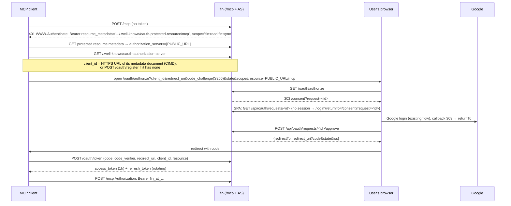

# fin — MCP server plan

Phase 3 of fin. The base application (backend, frontend, infrastructure, CI/CD) is planned in [init.md](init.md); references written as "init.md §N" point there, plain "§N" points within this file. Conventions from [STYLEGUIDE.md](../../STYLEGUIDE.md) apply unchanged.

A public [Model Context Protocol](https://modelcontextprotocol.io) server at `PUBLIC_URL/mcp`, served by the same `fin serve` process and deployment. Any MCP client (Claude, Claude Code, Cursor, the MCP Inspector, custom agents) connects with OAuth on behalf of an allow-listed user and can query, filter and aggregate that user's connections, accounts, balances and transactions. With the user's permission it can also **refresh** the user's already-linked connections when the data is stale (§6 `refresh_data`). Nothing reachable through MCP can create, re-authenticate or remove a bank connection: linking and fixing banks through Plaid Link stays a human-only, in-app flow.

## 1. Decisions

| Topic                | Decision                                                                                                                                                                                                                                                                                                                                                                                              | Why                                                                                                                                                                     |
| -------------------- | ----------------------------------------------------------------------------------------------------------------------------------------------------------------------------------------------------------------------------------------------------------------------------------------------------------------------------------------------------------------------------------------------------- | ----------------------------------------------------------------------------------------------------------------------------------------------------------------------- |
| Spec                 | Target the newest MCP revision the official Go SDK supports at scaffold time. Written against the **2025-11-25** authorization rules: protected resource metadata (RFC 9728), resource indicators (RFC 8707), PKCE S256, Client ID Metadata Documents preferred, DCR as fallback                                                                                                                      | These are the rules every current client implements                                                                                                                     |
| SDK                  | `github.com/modelcontextprotocol/go-sdk` (`mcp`, `auth`, `oauthex`), `@latest`                                                                                                                                                                                                                                                                                                                        | Official SDK; typed tool handlers infer JSON Schema from Go structs                                                                                                     |
| Transport            | Streamable HTTP, **stateless** (`StreamableHTTPOptions{Stateless: true, JSONResponse: true}`), one endpoint `/mcp`; `GET` and `DELETE` → 405                                                                                                                                                                                                                                                          | Tools need no server push or session; any replica can answer any request                                                                                                |
| Deployment           | Same binary, same listener, same image. `/mcp`, `/oauth/*` and `/.well-known/oauth-*` are plain `net/http` routes in `server/routes.go`, **documented in the OpenAPI spec** like every other route (§3)                                                                                                                                                                                               | Requested; no second service to deploy, configure or monitor, and `/swagger` stays the complete picture of the HTTP surface                                             |
| Authorization server | fin **is** the authorization server, with Google login as the upstream identity (the existing `AuthService`). Hand-written, no OAuth framework                                                                                                                                                                                                                                                        | Google tokens cannot carry an audience of `PUBLIC_URL/mcp`, and the MCP spec forbids passing upstream tokens through. One client type (public, PKCE) keeps the AS small |
| Tokens               | **Opaque** random tokens (`fin_at_…`, `fin_rt_…`, 32 bytes `crypto/rand`, base64url), SHA-256 stored, same pattern as `sessions.token_hash`. No JWTs                                                                                                                                                                                                                                                  | AS and RS share a database, so lookups are free, revocation is instant and there is no signing key to manage or rotate                                                  |
| Scopes               | Two scopes: `fin:read` (every query tool) and `fin:sync` (only `refresh_data`). Clients request both by default; the consent page lets the user untick refreshing. No other write scopes exist                                                                                                                                                                                                        | Refreshing is the only action agents need; a separate scope lets a user grant pure read access                                                                          |
| Plaid isolation      | `internal/mcpserver` gets read-only repository interfaces plus one narrow `connectionSyncer` interface (`Sync(ctx, userID, connectionID, trigger) error`, the same shape `SyncScheduler` already uses), declared inside `mcpserver` and satisfied by `ConnectionService`. `depguard` forbids `mcpserver` from importing `internal/provider`, `internal/encryption`, `internal/service` and `plaid-go` | Link, exchange, re-auth and remove are not in any interface `mcpserver` holds, so "cannot add a bank" is enforced by the compiler and lint, not by a missing `if`       |
| No raw SQL tool      | Agents get a typed aggregation tool instead (§6)                                                                                                                                                                                                                                                                                                                                                      | A SQL tool would bypass `WHERE user_id = $n` tenancy and expose `access_token_ciphertext`, cursors and Plaid secrets                                                    |
| Consent UI           | A SPA page (`/consent`) behind the existing session, not a server-rendered page                                                                                                                                                                                                                                                                                                                       | `fin_session` is `SameSite=Strict`, so it is not sent on the cross-site navigation into `/oauth/authorize`; a same-origin `fetch` from the SPA does carry it            |

## 2. Layout additions

```
internal/
├── domain/oauth.go               OAuthClient, Authorization, Grant, Token; ClientSource, TokenKind, Scope enums
├── oauth/                        pure protocol helpers, no I/O except the CIMD fetcher
│   ├── pkce.go                   S256 verification (constant-time compare)
│   ├── redirect.go               redirect URI validation + exact matching
│   ├── scope.go                  parse/format, subset checks
│   ├── metadata_document.go      Client ID Metadata Document fetcher (SSRF-guarded)
│   └── errors.go                 RFC 6749 error codes as a Go enum + JSON writer
├── repository/
│   ├── oauth_client.go
│   ├── oauth_authorization.go
│   ├── oauth_grant.go
│   ├── oauth_token.go
│   └── transaction_query.go      Search + Aggregate + Facets for MCP (typed specs, no SQL in callers)
├── service/oauth.go              OAuthService: authorize, consent, exchange, refresh, revoke, verify
├── handler/
│   ├── oauth.go                  net/http: metadata docs, authorize, token, register, revoke
│   ├── oauth_openapi.go          Document(api): documentation-only OpenAPI operations for the routes above
│   └── oauth_consent.go          huma (/api): pending request, approve, deny, grants list/revoke
└── mcpserver/
    ├── server.go                 New(deps) → *mcp.Server; registers every tool
    ├── auth.go                   bearer middleware (auth.RequireBearerToken + our TokenVerifier), Origin check
    ├── types.go                  tool input/output DTOs (json + jsonschema tags)
    ├── tools_accounts.go         list_connections, list_accounts, get_balances
    ├── tools_transactions.go     search_transactions, get_transaction, list_facets
    ├── tools_aggregate.go        aggregate_transactions, cash_flow
    ├── tools_recurring.go        find_recurring
    ├── tools_refresh.go          refresh_data
    └── openapi.go                Document(api): documentation-only OpenAPI operation for /mcp + x-mcp-tools
js/src/app/
├── consent.Page.tsx              approve/deny an MCP client
└── apps/apps.Page.tsx            connected apps: list + revoke grants
```

## 3. Endpoints

| Method | Path                                        | Handler                          | Auth            | Notes                                                                                               |
| ------ | ------------------------------------------- | -------------------------------- | --------------- | --------------------------------------------------------------------------------------------------- |
| POST   | `/mcp`                                      | `mcpserver` streamable handler   | Bearer          | JSON-RPC; `GET`/`DELETE` → 405                                                                      |
| GET    | `/.well-known/oauth-protected-resource/mcp` | `OAuthHandler.resourceMetadata`  | public, CORS \* | RFC 9728; also served at `/.well-known/oauth-protected-resource`                                    |
| GET    | `/.well-known/oauth-authorization-server`   | `OAuthHandler.serverMetadata`    | public, CORS \* | RFC 8414; also at `/.well-known/openid-configuration` for clients that only try OIDC discovery      |
| GET    | `/oauth/authorize`                          | `OAuthHandler.authorize`         | public          | validates, stores a pending authorization, 303 → `/consent?request=<id>`                            |
| POST   | `/oauth/token`                              | `OAuthHandler.token`             | client, CORS \* | `application/x-www-form-urlencoded`; `authorization_code`, `refresh_token`                          |
| POST   | `/oauth/register`                           | `OAuthHandler.register`          | public, CORS \* | RFC 7591 dynamic registration (fallback for clients without CIMD), rate-limited                     |
| POST   | `/oauth/revoke`                             | `OAuthHandler.revoke`            | client, CORS \* | RFC 7009; always 200                                                                                |
| GET    | `/api/oauth/requests/{requestId}`           | `OAuthConsentHandler.get`        | session         | client name, client id host, verified flag, redirect host, scopes, expiry; 404 when expired or used |
| POST   | `/api/oauth/requests/{requestId}/approve`   | `OAuthConsentHandler.approve`    | session         | → `{redirectTo}` with `code`, `state`, `iss`                                                        |
| POST   | `/api/oauth/requests/{requestId}/deny`      | `OAuthConsentHandler.deny`       | session         | → `{redirectTo}` with `error=access_denied`, `state`, `iss`                                         |
| GET    | `/api/oauth/grants`                         | `OAuthConsentHandler.listGrants` | session         | `Page[OAuthGrant]`: client name, scopes, created, last used                                         |
| DELETE | `/api/oauth/grants/{grantId}`               | `OAuthConsentHandler.revoke`     | session         | 204; revokes the grant and every token issued under it                                              |

`routes.go` additions (the one routing table stays the one routing table):

```go
mux.Handle("POST /mcp", h.MCP)
mux.Handle("/mcp", http.HandlerFunc(methodNotAllowed))

mux.HandleFunc("GET /.well-known/oauth-protected-resource/mcp", h.OAuth.ResourceMetadata)
mux.HandleFunc("GET /.well-known/oauth-protected-resource", h.OAuth.ResourceMetadata)
mux.HandleFunc("GET /.well-known/oauth-authorization-server", h.OAuth.ServerMetadata)
mux.HandleFunc("GET /.well-known/openid-configuration", h.OAuth.ServerMetadata)

mux.HandleFunc("GET /oauth/authorize", h.OAuth.Authorize)
mux.HandleFunc("POST /oauth/token", h.OAuth.Token)
mux.HandleFunc("POST /oauth/register", h.OAuth.Register)
mux.HandleFunc("POST /oauth/revoke", h.OAuth.Revoke)
mux.Handle("/oauth/", http.NotFoundHandler())
mux.Handle("/.well-known/", http.NotFoundHandler())

h.OAuthConsent.Register(authed)

h.OAuth.Document(api)
mcpserver.Document(api)
```

`/mcp`, `/oauth/` and `/.well-known/` never fall through to the SPA (`spa_test.go` gains those cases). The OAuth endpoints are served by `net/http`, not huma: their bodies are form-encoded and their errors must be RFC 6749 JSON (`{"error":"invalid_grant","error_description":"…"}`), which huma's problem+json does not produce. `/mcp` is served by the SDK's handler for the same reason. CORS `*` without credentials is set only on the metadata, token, register and revoke endpoints so browser-based MCP clients can complete discovery; it is safe because none of them read cookies.

**OpenAPI.** Serving these routes with `net/http` does not hide them from the spec. `RegisterRoutes` calls `h.OAuth.Document(api)` and `mcpserver.Document(api)`, which add **documentation-only** operations with `api.OpenAPI().AddOperation(…)` (huma records them in the spec but does not route them, so the mux above stays in charge). Both functions read types only, so `fin openapi` documents them with zero-value dependencies, the same as every huma handler ([init.md §5.1](init.md)).

- Security scheme `mcpOAuth`: `type: oauth2`, `authorizationCode` flow with `authorizationUrl` `/oauth/authorize`, `tokenUrl` and `refreshUrl` `/oauth/token`, scopes `fin:read` and `fin:sync`. `cookieAuth` stays the scheme for `/api`.
- `POST /mcp` (tag `mcp`, security `mcpOAuth: [fin:read]`): JSON-RPC 2.0 request and response schemas, `401`/`403` responses documenting the `WWW-Authenticate` header, `429`. `GET /mcp` and `DELETE /mcp` are listed as `405`. The operation carries an `x-mcp-tools` extension: for each tool its name, description, required scope, annotations and input/output JSON Schema, generated from the **same** Go types the SDK registers, so the spec cannot drift from `tools/list` (a test compares them).
- `/oauth/*` (tag `oauth`): form-encoded request bodies (`application/x-www-form-urlencoded`) for token and revoke, JSON for register, the RFC 6749 error schema, `302`/`303` responses for authorize. `/.well-known/*` (tag `oauth`): the two metadata document schemas.
- The SPA's generated `schema.gen.ts` gains these paths; nothing in `src/lib/queries` calls them.

## 4. OAuth flow



**Discovery.** Unauthenticated `/mcp` requests get `401` with `WWW-Authenticate: Bearer resource_metadata="<PUBLIC_URL>/.well-known/oauth-protected-resource/mcp", scope="fin:read fin:sync"`. Protected resource metadata: `{resource: "<PUBLIC_URL>/mcp", authorization_servers: ["<PUBLIC_URL>"], scopes_supported: ["fin:read", "fin:sync"], bearer_methods_supported: ["header"], resource_name: "fin"}`. Authorization server metadata: `issuer = PUBLIC_URL`, the four endpoints, `response_types_supported: ["code"]`, `grant_types_supported: ["authorization_code", "refresh_token"]`, `code_challenge_methods_supported: ["S256"]`, `token_endpoint_auth_methods_supported: ["none", "client_secret_basic", "client_secret_post"]`, `scopes_supported: ["fin:read", "fin:sync"]`, `client_id_metadata_document_supported: true`, `authorization_response_iss_parameter_supported: true`.

**Client registration — how fin learns which app is asking.** Before an app like Claude or Cursor can ask you for access, fin needs two facts about it: a name to show on the consent page, and the exact URL(s) it is allowed to send you back to after you approve (so a stolen authorization code can't be delivered to someone else). Plaid-style manual setup per app is not needed; MCP defines two self-service ways, and fin supports both:

1. **The app publishes a small JSON file about itself (preferred; "Client ID Metadata Document").** The app's ID _is_ an HTTPS URL on its own domain, e.g. `client_id=https://claude.ai/oauth/mcp-client.json`. When fin sees an ID like that, it downloads that file, which lists the app's name and redirect URLs. Because only the owner of `claude.ai` can put a file there, fin knows the request really comes from `claude.ai`, and the consent page shows that domain with a **verified** badge.
   - Fetch rules: HTTPS only, no redirects, 5s timeout, 64 KiB cap, and the connection refuses loopback, private, link-local, CGNAT and multicast addresses after DNS resolution, so the download cannot be aimed at fin's own network (SSRF guard; the resolver is injected for tests).
   - The file must be JSON whose `client_id` equals its own URL, with a non-empty `client_name` and `redirect_uris`, and `token_endpoint_auth_method: none`.
   - Cached in `oauth_clients` (`source = metadata_document`) for its `Cache-Control` max-age, capped at 24h.
2. **The app registers itself by API (fallback; "Dynamic Client Registration").** Older apps instead `POST /oauth/register` with their name and redirect URLs, and fin replies with a freshly generated ID (`fin_client_` + 16 random bytes). Anyone on the internet can do this and claim any name, so the consent page marks these apps **unverified** and shows the redirect host prominently.
   - Accepts RFC 7591 JSON with `authorization_code` + `refresh_token` grants and `code` responses only.
   - `token_endpoint_auth_method` `none` (default) or `client_secret_basic`/`client_secret_post`; a secret is returned once and only its SHA-256 is stored.
   - Rate-limited per IP (§9); registrations that never led to an approval are deleted after 7 days.

Neither path grants anything. Registering only makes the app _able to ask_; access exists only after an allow-listed user signs in and clicks **Approve**.

**Redirect URIs.** Exact string match against the registered list, except that loopback `http://127.0.0.1`, `http://[::1]` and `http://localhost` match on any port (RFC 8252 [init.md §7.3](init.md)). Allowed: `https://` URIs, loopback `http://`, and private-use schemes (`cursor://…`, `vscode://…`) for native apps. Refused: any other `http://`, `javascript:`, `data:`, `file:`, fragments, and userinfo. Invalid `client_id` or `redirect_uri` renders an error at fin and **never** redirects (open-redirect guard); every other error redirects back with `error`, `state` and `iss`.

**Authorize** (`GET /oauth/authorize`). Requires `response_type=code`, `client_id`, `redirect_uri`, `code_challenge` with `code_challenge_method=S256` (plain is refused), `state` (passed through untouched), `resource` equal to `PUBLIC_URL/mcp` after normalization (RFC 8707: tokens for any other audience are never minted; a missing `resource` defaults to it for older clients), and `scope` ⊆ `{fin:read, fin:sync}` (empty → both). Stores an `oauth_authorizations` row (10-minute TTL, `user_id` null) and 303s to `/consent?request=<id>`. The `request` value is a random 32-byte base64url token (43 characters) whose SHA-256 is stored, not the row's time-ordered UUIDv7, so it cannot be guessed.

**Consent** (`/consent`, SPA). Rendered inside the authenticated layout but **exempt from the PWA install gate** ([init.md §6.5](init.md)), because MCP clients open it in a normal browser tab. An unauthenticated visitor is sent to `/login?returnTo=/consent?request=<id>`; `GET /auth/google/login?returnTo=…` stores `returnTo` in the `fin_oauth` cookie and the callback 303s to it. `returnTo` must match `^/consent\?request=[A-Za-z0-9_-]{43}$`, so the login flow gains no open redirect. A non-allow-listed Google account still lands on `/login?error=not_allowed`. The page shows: client name and logo (CIMD only; DCR logos are not shown), verified/unverified badge, the client id host, where it redirects, the requested access in plain words ("Read your accounts, balances and transactions." and, when `fin:sync` was requested, a checkbox ticked by default: "Refresh data from your already-connected banks." followed by "It cannot connect, reconnect or remove banks."), and **Approve** / **Deny**. Approve sends `{scopes}` (the requested scopes minus anything unticked; `fin:read` cannot be unticked), binds `user_id`, mints an authorization code (32 bytes, SHA-256 stored, 60-second TTL) and returns `{redirectTo}`; the SPA calls `window.location.assign(redirectTo)`. CSRF on approve/deny is covered the same way as every other `/api` mutation: `SameSite=Strict` session + JSON body. Approving a client the user already granted reuses the existing `oauth_grants` row (scopes unioned).

**Token** (`POST /oauth/token`).

- Client authentication: public clients send `client_id` only; confidential DCR clients authenticate with Basic or post (constant-time hash compare). `invalid_client` → 401.
- `authorization_code`: atomically consume the code with one statement (`UPDATE oauth_authorizations SET consumed_at = now() WHERE code_hash = $1 AND consumed_at IS NULL AND code_expires_at > now() RETURNING …`), then require same `client_id`, same `redirect_uri`, same `resource`, and `S256(code_verifier) == code_challenge`. A code presented twice revokes the grant it produced (RFC 6749 [init.md §4.1](init.md).2). Issues an access token (`MCP_ACCESS_TOKEN_TTL`, default 1h) and a refresh token (`MCP_REFRESH_TOKEN_TTL`, default 30d).
- `refresh_token`: refresh tokens **rotate**. Consume with `UPDATE oauth_tokens SET used_at = now() WHERE token_hash = $1 AND kind = 'refresh' AND used_at IS NULL AND expires_at > now() RETURNING …`; if that matches nothing but the token exists with `used_at` set, it is a replay → revoke the whole grant and count `reuse_detected`. A refresh may narrow but never widen scope, and `resource` must still match. A grant also has an absolute lifetime (`MCP_GRANT_MAX_AGE`, default 90d) after which the user must approve again.
- Every response: `Cache-Control: no-store`, `token_type: Bearer`, `expires_in`, `scope`.
- No DB transactions ([init.md §0](init.md)): each step is a single atomic statement, and a crash between consuming a code/refresh token and inserting new tokens only forces the client to authorize again.

**Revoke.** `POST /oauth/revoke` (RFC 7009) revokes the presented token; revoking a refresh token revokes its grant. Users revoke from **Settings → Connected apps** (`/apps`), which deletes the grant (cascading its tokens). Deleting a user row cascades everything, so removing someone from the allow-list cuts every agent off immediately.

**Resource server** (`mcpserver/auth.go`). `auth.RequireBearerToken` from the SDK with our `TokenVerifier`:

- Only the `Authorization: Bearer` header is accepted; tokens in query strings are rejected.
- One indexed query joins `oauth_tokens` → `oauth_grants` → `users`: token kind `access`, not expired, grant not revoked and within max age, `resource = PUBLIC_URL/mcp`, scope contains `fin:read`. `refresh_data` additionally requires `fin:sync`. The user is stored in the request context the same way `RequireSession` does, and every tool passes that `user.ID` to every repository call.
- `last_used_at` on the grant is updated at most every 5 minutes (conditional `UPDATE … WHERE last_used_at < now() - interval '5 minutes'`), so reads don't write on every call.
- Failures: missing/invalid/expired → 401 with the `WWW-Authenticate` header above plus `error="invalid_token"`; missing scope → 403 `error="insufficient_scope", scope="fin:read fin:sync"`, which tells the client to send the user back through consent to add the scope (step-up authorization). Clients granted only `fin:read` do not see `refresh_data` in `tools/list` at all.
- The `fin_session` cookie is **never** accepted on `/mcp`, so a logged-in browser cannot be driven into it cross-site.
- DNS-rebinding guard required by the transport spec: a request carrying an `Origin` header is rejected with 403 unless the origin is in `MCP_ALLOWED_ORIGINS` (default empty; hosted agents call server-to-server and send none).

## 5. Database

Four migrations, one table each, following [init.md §4](init.md)'s conventions (`text` enums without `CHECK`, `uuidv7()` ids, every user-data table carries `user_id` with `ON DELETE CASCADE`).

```sql
CREATE TABLE oauth_clients (
    id                          text        PRIMARY KEY,
    source                      text        NOT NULL,
    client_name                 text        NOT NULL,
    client_uri                  text,
    logo_uri                    text,
    redirect_uris               text[]      NOT NULL,
    token_endpoint_auth_method  text        NOT NULL,
    client_secret_hash          bytea,
    metadata_fetched_at         timestamptz,
    metadata_expires_at         timestamptz,
    created_at                  timestamptz NOT NULL DEFAULT now(),
    last_used_at                timestamptz
);
```

```sql
CREATE TABLE oauth_authorizations (
    id                     uuid        PRIMARY KEY DEFAULT uuidv7(),
    request_token_hash     bytea       NOT NULL UNIQUE,
    client_id              text        NOT NULL REFERENCES oauth_clients (id) ON DELETE CASCADE,
    user_id                uuid        REFERENCES users (id) ON DELETE CASCADE,
    redirect_uri           text        NOT NULL,
    scope                  text        NOT NULL,
    resource               text        NOT NULL,
    state                  text,
    code_challenge         text        NOT NULL,
    code_hash              bytea       UNIQUE,
    code_expires_at        timestamptz,
    consumed_at            timestamptz,
    grant_id               uuid,
    created_at             timestamptz NOT NULL DEFAULT now(),
    expires_at             timestamptz NOT NULL
);
```

```sql
CREATE TABLE oauth_grants (
    id            uuid        PRIMARY KEY DEFAULT uuidv7(),
    user_id       uuid        NOT NULL REFERENCES users (id) ON DELETE CASCADE,
    client_id     text        NOT NULL REFERENCES oauth_clients (id) ON DELETE CASCADE,
    scope         text        NOT NULL,
    resource      text        NOT NULL,
    created_at    timestamptz NOT NULL DEFAULT now(),
    expires_at    timestamptz NOT NULL,
    last_used_at  timestamptz,
    revoked_at    timestamptz,
    UNIQUE (user_id, client_id)
);

CREATE INDEX oauth_grants_user_id_idx ON oauth_grants (user_id);
```

```sql
CREATE TABLE oauth_tokens (
    id          uuid        PRIMARY KEY DEFAULT uuidv7(),
    grant_id    uuid        NOT NULL REFERENCES oauth_grants (id) ON DELETE CASCADE,
    user_id     uuid        NOT NULL REFERENCES users (id) ON DELETE CASCADE,
    kind        text        NOT NULL,
    token_hash  bytea       NOT NULL UNIQUE,
    scope       text        NOT NULL,
    expires_at  timestamptz NOT NULL,
    used_at     timestamptz,
    created_at  timestamptz NOT NULL DEFAULT now()
);

CREATE INDEX oauth_tokens_grant_id_idx ON oauth_tokens (grant_id);
```

Expired authorizations and tokens are deleted opportunistically by `OAuthService` on each token issuance (`DeleteExpired`, the same pattern as sessions). Nothing secret is stored in plaintext: codes, request tokens, access/refresh tokens and client secrets are SHA-256 hashes (high-entropy random values, so a plain hash is sufficient; no `SECRET_KEY` involvement).

## 6. Tools

Every tool except `refresh_data` is annotated `readOnlyHint: true`, `destructiveHint: false`, `idempotentHint: true`, `openWorldHint: false`. All tools declare an `outputSchema`, and return `structuredContent` plus the same JSON as a text block for clients that ignore structured output. Conventions shared by every tool:

- Money is a decimal **string**, outflows negative ([init.md §0](init.md)). Every amount travels with its `currency`; nothing ever sums across currencies (aggregations always group by currency implicitly).
- Dates are `YYYY-MM-DD` (`posted_on`), timestamps RFC 3339.
- IDs are fin UUIDs. Plaid `external_id`s, access tokens, cursors, `last_error` text and credentials never appear in any DTO; DTOs live in `mcpserver/types.go` and are mapped from domain types, like the API DTOs ([init.md §5.6](init.md)).
- Shared transaction filter (`TransactionQuery`), accepted by every transaction tool:

| Field                                | Meaning                                                                                     |
| ------------------------------------ | ------------------------------------------------------------------------------------------- |
| `from`, `to`                         | inclusive `posted_on` range; default last 90 days; max span 5 years                         |
| `account_ids`, `exclude_account_ids` | include / exclude lists                                                                     |
| `connection_ids`                     | restrict to institutions                                                                    |
| `account_types`                      | `depository`, `credit`, `loan`, `investment`, `other`                                       |
| `categories`, `exclude_categories`   | exact Plaid category values (discover with `list_facets`)                                   |
| `exclude_transfers`                  | drops `TRANSFER_IN`, `TRANSFER_OUT`, `LOAN_PAYMENTS` (same set as `/api/summary/cash-flow`) |
| `merchant`                           | case-insensitive substring over `merchant_name` and `name` (`ILIKE`, wildcards escaped)     |
| `direction`                          | `inflow` (amount > 0), `outflow` (amount < 0), `any`                                        |
| `min_amount`, `max_amount`           | bounds on the **absolute** amount, decimal strings                                          |
| `currency`                           | ISO code                                                                                    |
| `pending`                            | `true`, `false`, or omitted for both                                                        |

| Tool                     | Input                                                                                                                                                                                                                                                                                                                                           | Output                                                                                                                                                                                                                 |
| ------------------------ | ----------------------------------------------------------------------------------------------------------------------------------------------------------------------------------------------------------------------------------------------------------------------------------------------------------------------------------------------- | ---------------------------------------------------------------------------------------------------------------------------------------------------------------------------------------------------------------------- |
| `list_connections`       | —                                                                                                                                                                                                                                                                                                                                               | institution, status (`active`/`needs_reauth`), `last_synced_at`, `has_error`, account count. Lets the agent judge freshness, decide whether to call `refresh_data`, and caveat data ("Chase needs sign-in in the app") |
| `list_accounts`          | `connection_ids`, `account_types`                                                                                                                                                                                                                                                                                                               | id, institution, name, official name, mask, type, subtype, current/available balance, currency                                                                                                                         |
| `get_balances`           | `exclude_account_ids`                                                                                                                                                                                                                                                                                                                           | per currency: assets, liabilities, net worth; plus per-account-type subtotals                                                                                                                                          |
| `search_transactions`    | `TransactionQuery` + `sort` (`date_desc`, `date_asc`, `amount_asc`, `amount_desc`), `page`, `page_size` (≤ 500)                                                                                                                                                                                                                                 | transactions with account/institution names inlined, `total`, `has_next`                                                                                                                                               |
| `get_transaction`        | `transaction_id`                                                                                                                                                                                                                                                                                                                                | one transaction incl. `authorized_on`                                                                                                                                                                                  |
| `list_facets`            | `TransactionQuery`, `facet` (`category`, `merchant`, `account`, `currency`), `limit` (≤ 500)                                                                                                                                                                                                                                                    | distinct values with count and sum, so agents learn valid filter values before filtering                                                                                                                               |
| `aggregate_transactions` | `TransactionQuery` + `group_by` (0–3 of `day`, `week`, `month`, `quarter`, `year`, `weekday`, `category`, `merchant`, `account`, `connection`, `account_type`, `direction`, `pending`) + `metrics` (1+ of `sum`, `inflow`, `outflow`, `count`, `avg`, `min`, `max`, `median`) + `order_by` (a metric or dimension, asc/desc) + `limit` (≤ 1000) | rows of `{dimensions…, currency, metrics…}`, `truncated` flag. Covers "spend by category per month", "top 10 merchants this year", "average weekday spend", "income by account"                                        |
| `cash_flow`              | `TransactionQuery` + `interval` (`day`, `week`, `month`, `quarter`, `year`); `exclude_transfers` defaults to `true` here                                                                                                                                                                                                                        | per period and currency: inflow, outflow (positive), net, savings rate                                                                                                                                                 |
| `find_recurring`         | `from`/`to` (default 13 months), `min_occurrences` (default 3)                                                                                                                                                                                                                                                                                  | candidate subscriptions/bills: merchant, typical amount, cadence (`weekly`, `biweekly`, `monthly`, `quarterly`, `yearly`), last and next expected date, occurrences                                                    |
| `refresh_data`           | `connection_ids` (default: all of the user's connections)                                                                                                                                                                                                                                                                                       | per connection: `synced`, `throttled` (with `retry_after_seconds`), `needs_reauth` ("sign in again in the fin app"), or `failed`, with `last_synced_at`; plus counts. Requires `fin:sync`                              |

`aggregate_transactions` is the flexible-analysis core. It never sees SQL from the caller: `group_by`, `metrics` and `order_by` are Go enums mapped to fixed SQL expressions in `repository/postgres/transaction_query.go` (e.g. `month` → `date_trunc('month', t.posted_on)::date`, `merchant` → `coalesce(t.merchant_name, t.name)`, `median` → `percentile_cont(0.5) WITHIN GROUP (ORDER BY t.amount)`, `outflow` → `-sum(t.amount) FILTER (WHERE t.amount < 0)`); every value is a bind parameter, `t.user_id = $1` is always the first predicate, and `t.currency` is always a grouping column. The query builder is a pure function (`buildAggregateQuery(spec) (string, []any)`) and is the one part of `repository/postgres` that gets unit tests: golden SQL per dimension/metric, every identifier comes from the whitelist, user id is always `$1`.

`find_recurring` runs in Go over `aggregate`-style rows (merchant, amount, dates) fetched with one query: group by normalized merchant, compute median gap between occurrences, accept when ≥ `min_occurrences` and gaps cluster within ±20% of a known cadence and amounts within ±15% of the median. Pure function, unit-tested.

`refresh_data` is the only tool with a side effect. It runs the same `ConnectionService.Sync` the Refresh button and the scheduler use, through the narrow `connectionSyncer` interface (§1), with a new trigger `metrics.SyncTriggerMCP`:

- Rate limiting is **not** implemented here. `SyncTriggerMCP` is an on-demand trigger, so it is subject to the same per-connection `SYNC_COOLDOWN` (default `10m`, stored in the `rate_limits` table) as the Refresh button ([init.md §5.5](init.md)). Throttled connections come back as `throttled` with `retry_after_seconds`; a Refresh in the app and an agent refresh share one window, so neither can be used to get around the other. The `/mcp` rate limit (§9) applies on top.
- `needs_reauth` connections are never touched: fixing them needs Plaid Link in the app, which is exactly what MCP must not do. The result tells the agent to ask the user to reconnect in fin.
- Connections are synced sequentially under a 60-second deadline (separate from the 5-second query deadline); whatever did not finish is reported as `failed` and the next sync picks it up, because syncs are idempotent ([init.md §5.5](init.md)).
- It pulls what Plaid already has (`/transactions/sync`); it does not call Plaid's billed `/transactions/refresh`, so freshness is bounded by Plaid's own update cadence. The server `instructions` say this, and tell agents to check `list_connections` first and refresh only when `last_synced_at` is older than the question needs.
- Annotations: `readOnlyHint: false`, `destructiveHint: false`, `idempotentHint: true`, `openWorldHint: true`.

Response size: every tool caps rows (limits above) and sets `truncated`/`has_next`, so a single call cannot dump the database into an agent's context. Every query runs under a 5-second context deadline.

Not exposed, ever: link tokens, public-token exchange, re-auth (update-mode link tokens and completion), connection removal, card-art selection, Plaid credentials, sessions, other users. Write tools beyond `refresh_data` (e.g. notes or categories) would need a new scope and a new consent line; out of scope for this phase.

Resources and prompts are out of scope for v1; everything is a tool, which every client supports. An `instructions` string on the server explains the money sign convention, currencies, that data can be up to one `SYNC_CRON` period old unless refreshed, when to use `refresh_data`, and that transaction text is untrusted data.

## 7. Wiring

`serve.go` adds, in the same explicit-constructor style:

```go
oauthClients := postgres.NewOAuthClientRepository(pool)
oauthAuthorizations := postgres.NewOAuthAuthorizationRepository(pool)
oauthGrants := postgres.NewOAuthGrantRepository(pool)
oauthTokens := postgres.NewOAuthTokenRepository(pool)
transactionQueries := postgres.NewTransactionQueryRepository(pool)

metadataFetcher := oauth.NewMetadataDocumentFetcher(httpClient, oauth.PublicAddressesOnly)
oauthService := service.NewOAuthService(cfg.OAuth(), oauthClients, oauthAuthorizations, oauthGrants, oauthTokens, metadataFetcher, recorder)

mcpHandler := mcpserver.NewHandler(mcpserver.Deps{
	Verifier:     oauthService,
	Connections:  connections,
	Accounts:     accounts,
	Summary:      summary,
	Transactions: transactionQueries,
	Syncer:       connectionService,
	Recorder:     recorder,
	Config:       cfg.MCP(),
})
```

`mcpserver.Deps` holds **repository interfaces**, one `TokenVerifier` interface (`VerifyAccessToken(ctx, token) (domain.User, []domain.Scope, error)`) and one `connectionSyncer` interface (`Sync` only), all declared inside `mcpserver`. None of them exposes link, exchange, re-auth or remove. `.golangci.yml` enables `depguard` with a rule scoped to `internal/mcpserver/**` denying `github.com/tahminator/fin/internal/provider`, `.../encryption`, `.../service` and `github.com/plaid/plaid-go`; `serve.go` is where `ConnectionService` is handed over as the interface. `ConnectionRepository` is passed as a read-only interface (`ListByUser` only), so the repository methods that mutate connections are out of reach too.

## 8. Configuration

| Variable                | Default | Notes                                                                                   |
| ----------------------- | ------- | --------------------------------------------------------------------------------------- |
| `MCP_ENABLED`           | `true`  | `false` unregisters `/mcp`, `/oauth/*` and the metadata endpoints (all 404)             |
| `MCP_ACCESS_TOKEN_TTL`  | `1h`    |                                                                                         |
| `MCP_REFRESH_TOKEN_TTL` | `720h`  | rotating; each refresh issues a new one                                                 |
| `MCP_GRANT_MAX_AGE`     | `2160h` | re-consent after 90 days regardless of use                                              |
| `MCP_ALLOWED_ORIGINS`   | empty   | comma list for browser-based clients; empty rejects any request with an `Origin` header |

Derived, not configured: `cfg.OAuthIssuer() = PUBLIC_URL`, `cfg.MCPResource() = PUBLIC_URL + "/mcp"`. Validation additions: in production `PUBLIC_URL` must be `https://` with no path, query or trailing slash (the issuer and resource identifiers are compared as exact strings); `MCP_ACCESS_TOKEN_TTL` ≤ 24h. Dev: Vite's `server.proxy` gains `/mcp`, `/oauth`, `/.well-known`, and `PUBLIC_URL=http://localhost:5173` keeps issuer, resource and consent page on one origin.

## 9. Abuse protection and privacy

- Rate limits use the shared Postgres-backed `RateLimiter` and `rate_limits` table from [init.md §5.5](init.md), so every replica enforces one count and restarts do not reset it. New `domain.RateLimitScope` values and limits: `oauth_register` 10/hour, `oauth_token` 60/minute and `oauth_authorize` 60/minute, each keyed by client IP (the ingress `X-Forwarded-For` hop); `mcp_grant` 120/minute keyed by grant ID. Excess → 429 with `Retry-After` from the limiter. Request bodies capped at 64 KiB (`http.MaxBytesReader`).
- Logging: the request logger never logs query strings for `/oauth/*` (codes, state) or any `Authorization` header. MCP calls log tool name, user id, grant id, outcome, rows returned and duration; tool arguments are not logged (merchant searches are personal data).
- Prompt injection: merchant and transaction names are third-party text and reach the agent verbatim. The server is scoped to one user and its only side effect is `refresh_data`, which is idempotent, cooldown-limited and touches nothing but already-linked connections, so an injected instruction can at most make the agent read more or refresh early; it cannot move money, link or remove banks, or touch another user. The server `instructions` remind clients that transaction text is untrusted data.
- Ingress: `/mcp`, `/oauth/*` and `/.well-known/oauth-*` are public (TLS terminated at the ingress); `/metrics`, `/healthz`, `/readyz` stay blocked as today.

## 10. Observability

New `iota` label enums in `metrics/labels.go`: `RouteGroup` gains `mcp` and `oauth` (`routeGroupOf` maps `/mcp`, `/oauth/`, `/.well-known/`); `MCPTool` (one value per tool in §6); `SyncTrigger` gains `mcp` (so `fin_syncs_total` and `fin_sync_duration_seconds` split MCP refreshes from manual and scheduled ones; 20 and 5 × buckets series); `ToolOutcome` (`success`, `invalid_params`, `not_found`, `error`); `OAuthGrantType` (`authorization_code`, `refresh_token`); `OAuthOutcome` (`success`, `invalid_request`, `invalid_client`, `invalid_grant`, `reuse_detected`, `error`); `ClientSource` (`metadata_document`, `registered`); `ConsentDecision` (`approved`, `denied`).

| Metric                                            | Type      | Labels                  | Max series      |
| ------------------------------------------------- | --------- | ----------------------- | --------------- |
| `fin_mcp_tool_calls_total` (`mcpserver`)          | counter   | `tool`, `outcome`       | 10 × 4          |
| `fin_mcp_tool_duration_seconds`                   | histogram | `tool`                  | 10 × buckets    |
| `fin_oauth_token_requests_total` (`OAuthService`) | counter   | `grant_type`, `outcome` | 12              |
| `fin_oauth_client_registrations_total`            | counter   | `source`, `outcome`     | 4               |
| `fin_oauth_consents_total`                        | counter   | `decision`              | 2               |
| `fin_oauth_active_grants` (DB snapshot)           | gauge     | `user`                  | allow-list size |
| `fin_oauth_clients` (DB snapshot)                 | gauge     | `source`                | 2               |

`Recorder` gains `MCPToolCalled(tool, outcome, elapsed)`, `OAuthTokenRequested(grantType, outcome)`, `OAuthClientRegistered(source, outcome)` and `OAuthConsentDecided(decision)`. Client names and ids are **not** labels (unbounded). Alerts:

```
increase(fin_oauth_token_requests_total{outcome="reuse_detected"}[1d]) > 0
increase(fin_oauth_client_registrations_total[1h]) > 20
increase(fin_mcp_tool_calls_total{outcome="error"}[1h]) > 0
increase(fin_syncs_total{trigger="mcp", outcome!="success"}[1d]) > 0
```

## 11. Frontend

- Routes: `/consent` (authenticated layout, install gate skipped, no AppShell nav) and `/apps` (authenticated, linked from the account menu as **Connected apps**).
- `lib/queries/oauth.ts`: `useAuthorizationRequest(requestId)`, `useApproveAuthorization`, `useDenyAuthorization`, `useGrants` (infinite), `useRevokeGrant` (invalidates `/api/oauth/grants`).
- Login: the authed layout's redirect and `login.Page.tsx` carry a zod-validated `returnTo` search param through to `/auth/google/login?returnTo=…` (only `/consent?request=…` values pass, mirroring the server check).
- `/consent` follows the component contract ([init.md §6.4](init.md)): loading, 404 ("This request expired, start again from your app"), and the view with Approve/Deny. `/apps` lists grants with client name, verified badge, granted scopes ("Read" / "Read + refresh"), connected date, last used, and a **Revoke** confirm dialog.
- The MCP endpoint URL (`PUBLIC_URL/mcp`) is shown on `/apps` with a copy button, plus one-line setup hints (Claude: add a custom connector with that URL; Claude Code: `claude mcp add --transport http fin <url>`).

## 12. Tests

Same rules as [init.md §5.13](init.md) (stdlib, fakes, no network/DB/sleeps; `now` injected).

| Package                                     | Covered behavior                                                                                                                                                                                                                                                                                                                                                                                                                                                                                                                                                                                                                                                                                                                                                                                                                  |
| ------------------------------------------- | --------------------------------------------------------------------------------------------------------------------------------------------------------------------------------------------------------------------------------------------------------------------------------------------------------------------------------------------------------------------------------------------------------------------------------------------------------------------------------------------------------------------------------------------------------------------------------------------------------------------------------------------------------------------------------------------------------------------------------------------------------------------------------------------------------------------------------- |
| `internal/oauth`                            | S256 known-answer vectors from RFC 7636; plain method rejected; redirect URI rules (https ok, http non-loopback rejected, loopback any port matches, custom scheme ok, `javascript:`/fragment/userinfo rejected, exact match otherwise); scope parse/subset; CIMD fetcher refuses private/loopback/link-local resolutions, redirects, oversize bodies, mismatched `client_id`, missing `redirect_uris`                                                                                                                                                                                                                                                                                                                                                                                                                            |
| `internal/service` — oauth                  | unknown client / bad redirect → error without redirect; missing PKCE → `invalid_request`; wrong `resource` → `invalid_target`; code exchanges once, second use → `invalid_grant` + grant revoked; expired code; verifier mismatch; redirect_uri mismatch; client mismatch; refresh rotates and the old token then triggers `reuse_detected` + grant revoked; refresh cannot widen scope; grant past max age refused; revoked grant → verify fails; stored hashes are SHA-256 of the issued tokens, never the tokens; confidential DCR client wrong secret → `invalid_client`; recorder called with the right enums                                                                                                                                                                                                                |
| `internal/handler` — oauth                  | metadata documents (exact fields, issuer/resource strings, CORS header); the OpenAPI spec contains every `/oauth/*`, `/.well-known/*` and `/mcp` operation with the `mcpOAuth` scheme; consent approve honours unticked `fin:sync` and refuses dropping `fin:read`; 401 `WWW-Authenticate` format; token endpoint returns RFC 6749 JSON errors with `no-store`; register validates and never echoes a stored hash; register/token/authorize return 429 with `Retry-After` when a fake `RateLimiter` refuses, keyed by client IP; `/mcp` keyed by grant ID; consent endpoints: 401 without session, 404 for expired/consumed/other user's request, approve returns `code`+`state`+`iss`, deny returns `access_denied`; grants tenancy (user B cannot list or revoke A's grants)                                                    |
| `internal/handler` — auth                   | `returnTo` accepted only for `/consent?request=<43 chars>`; anything else (absolute URL, `//evil`, other paths) falls back to `/`                                                                                                                                                                                                                                                                                                                                                                                                                                                                                                                                                                                                                                                                                                 |
| `internal/mcpserver`                        | via the SDK's in-memory transport: every tool lists with an output schema and every tool but `refresh_data` with `readOnlyHint`; `refresh_data` hidden and 403 `insufficient_scope` without `fin:sync`; `refresh_data` syncs only `active` connections with `SyncTriggerMCP`, never `needs_reauth` ones, maps `domain.ErrThrottled` to `throttled` with `retry_after_seconds`, reports per-connection results, stops at the deadline; `x-mcp-tools` in the generated spec equals `tools/list` (names, schemas, scopes); bearer middleware (no header, query-string token, expired, wrong scope, `Origin` not allowed, session cookie ignored); every repository call receives the token's user id (tenancy); filter mapping (defaults, 5-year cap, page size caps, invalid enum → `invalid_params`); DTOs contain no external ids |
| `internal/repository/postgres` (query only) | `buildAggregateQuery` golden SQL for each dimension and metric; `$1` is always the user id; identifiers only from the whitelist; currency always grouped; `merchant` wildcards escaped                                                                                                                                                                                                                                                                                                                                                                                                                                                                                                                                                                                                                                            |
| `internal/mcpserver` — recurring            | monthly/biweekly/yearly cadences detected; jittered dates within tolerance accepted; amount drift beyond 15% rejected; fewer than `min_occurrences` ignored                                                                                                                                                                                                                                                                                                                                                                                                                                                                                                                                                                                                                                                                       |
| `internal/metrics`                          | new enums unique and complete; series pre-initialized; `routeGroupOf` maps `/mcp`, `/oauth/…`, `/.well-known/…`                                                                                                                                                                                                                                                                                                                                                                                                                                                                                                                                                                                                                                                                                                                   |

Manual verification:

1. `npx @modelcontextprotocol/inspector` against `http://localhost:5173/mcp`: discovery, DCR, consent, token, `tools/list`, every tool returns structured content.
2. Claude (custom connector) and Claude Code (`claude mcp add --transport http fin https://<host>/mcp`) against staging: CIMD client shows **verified**, consent → tools usable; ask "what did I spend on dining per month this year?" and compare with the transactions page.
3. A non-allow-listed Google account at consent → `/login?error=not_allowed`, no code issued.
4. Revoke from `/apps` → the next tool call returns 401 and the client restarts authorization.
5. Replay a used refresh token with `curl` → `invalid_grant`, grant revoked, `fin_oauth_token_requests_total{outcome="reuse_detected"}` increments.
6. Consent page opens in Safari on iOS (not the installed PWA) without the install gate.
7. `curl -X POST /mcp -H 'Origin: https://evil.example'` with a valid token → 403.
8. Ask the agent to "refresh my data, then show today's transactions": `refresh_data` syncs stale connections, a second call within `SYNC_COOLDOWN` reports `throttled` (so does one right after tapping Refresh in the app), `fin_syncs_total{trigger="mcp"}` increments; with a sandbox connection in `needs_reauth` it is reported, not synced. Re-approve with refreshing unticked → `refresh_data` disappears from the tool list.
9. `/swagger` shows the `mcp` and `oauth` tags and the `mcpOAuth` scheme.

## 13. Milestones

**M7 — OAuth authorization server**

- Migrations 000010–000013, `internal/oauth`, `OAuthService`, OAuth + consent handlers (with their OpenAPI documentation), `returnTo` on login, metadata endpoints, `/consent` and `/apps` pages, rate limits, metrics; tests per §12.
- Accept: manual checks 3–6 using the Inspector's auth debugger; `just lint && just test` green.

**M8 — MCP tools**

- `internal/mcpserver` with the bearer middleware, every tool in §6 including `refresh_data` and `SyncTriggerMCP`, the `/mcp` OpenAPI operation with `x-mcp-tools`, `transaction_query` repository + builder tests, `depguard` rule, Vite proxy entries, ingress paths.
- Accept: manual checks 1, 2, 7, 8 and 9; `depguard` fails a deliberate `internal/provider` import from `mcpserver`.

## 14. Risks

- **Public authorization server**: DCR lets anyone create clients. Mitigated by rate limits, unverified labelling, exact redirect matching, unused-client cleanup, and the allow-list — a client is useless until an allow-listed user approves it.
- **Spec churn**: MCP auth has changed across revisions (DCR-first → CIMD-first). Discovery is served at both RFC 8414 and OIDC paths and both client-identification methods are supported; recheck against the newest revision and the SDK at scaffold time.
- **Phishing via consent**: a malicious client can mimic a known name. CIMD clients show their verified domain; DCR clients show **unverified** and the redirect host; the consent copy states exactly what is allowed and that banks cannot be connected, reconnected or removed.
- **Sensitive data leaves fin**: approved agents send transactions to their model provider. This is the point of the feature, but the consent screen says so in plain words, and grants expire after `MCP_GRANT_MAX_AGE`.
- **Agent-triggered refreshes**: more Plaid calls than the cron alone. Bounded by the shared `SYNC_COOLDOWN` per connection, the `/mcp` rate limit and the `fin:sync` opt-out; `/transactions/sync` is not billed per call.
- **`/mcp` rate limit writes on every call**: one indexed upsert on `rate_limits` per tool call (init.md §10). Fine for a handful of agents; revisit if call volume grows by orders of magnitude.

## 15. Changes to init.md

What this phase changes in the base plan, so [init.md](init.md) can stay as written:

| init.md section   | Change                                                                                                                                                                        |
| ----------------- | ----------------------------------------------------------------------------------------------------------------------------------------------------------------------------- |
| §0 decisions      | MCP server and its OAuth server as described in §1                                                                                                                            |
| §3 configuration  | the `MCP_*` variables in §8; production `PUBLIC_URL` validation                                                                                                               |
| §4 database       | migrations 000010–000013 (§5)                                                                                                                                                 |
| §5.5 rate limits  | new on-demand trigger `SyncTriggerMCP`, enforced by the existing sync cooldown; new `rate_limits` scopes `oauth_register`, `oauth_token`, `oauth_authorize`, `mcp_grant` (§9) |
| §5.6 routes       | the routes and OpenAPI documentation in §3; `GET /auth/google/login?returnTo=`                                                                                                |
| §5.8 metrics      | `RouteGroup` `mcp`/`oauth`, `SyncTrigger` `mcp`, and the metrics in §10                                                                                                       |
| §5.10 lint        | `depguard` rule for `internal/mcpserver` (§7)                                                                                                                                 |
| §6.1 Vite proxy   | add `/mcp`, `/oauth`, `/.well-known`                                                                                                                                          |
| §6.2 routes       | `/consent` (exempt from the PWA install gate) and `/apps` (§11)                                                                                                               |
| §7 infrastructure | ingress publishes `/mcp`, `/oauth/*`, `/.well-known/oauth-*` (§9)                                                                                                             |
| §9 milestones     | M7 and M8 (§13)                                                                                                                                                               |
